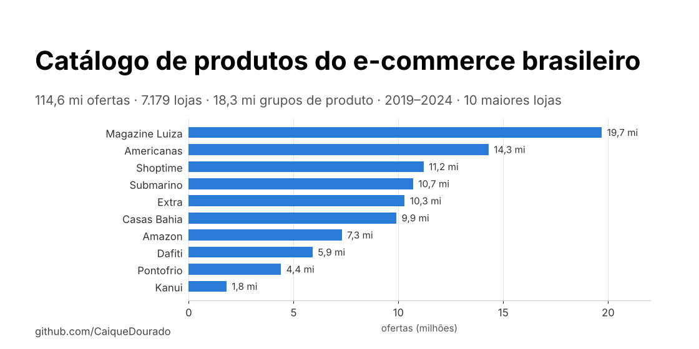
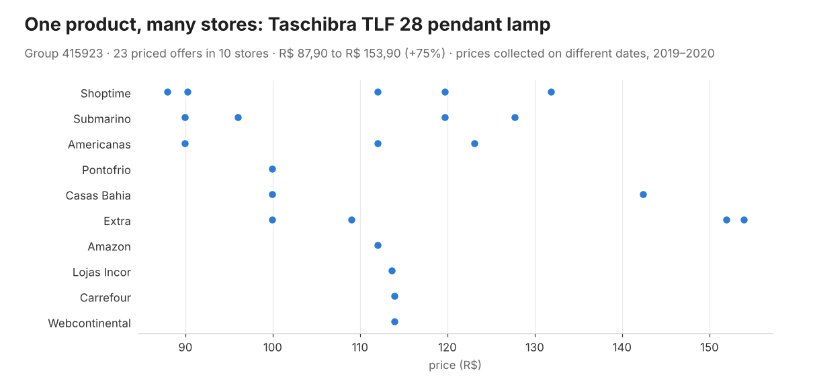
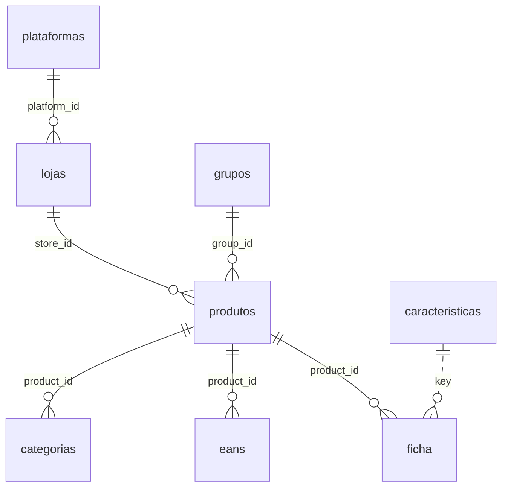
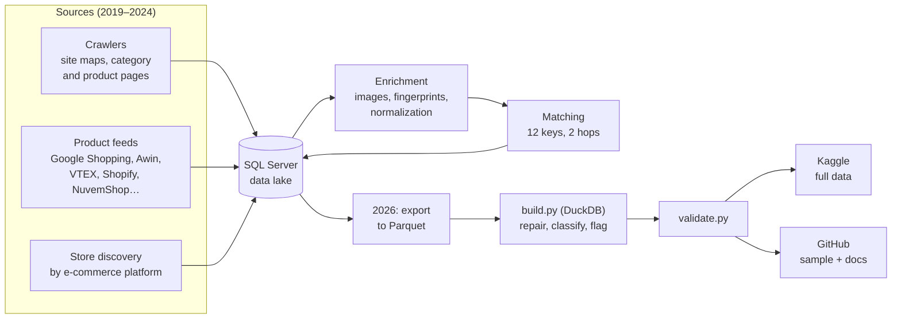
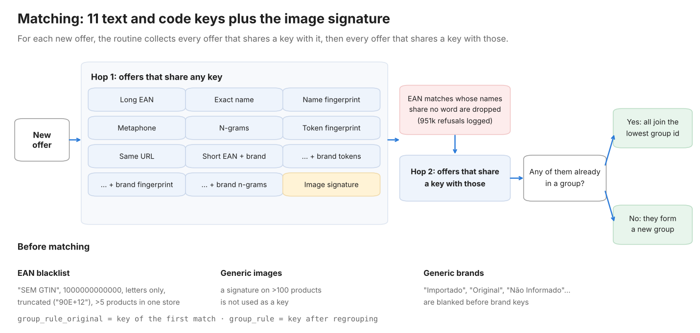
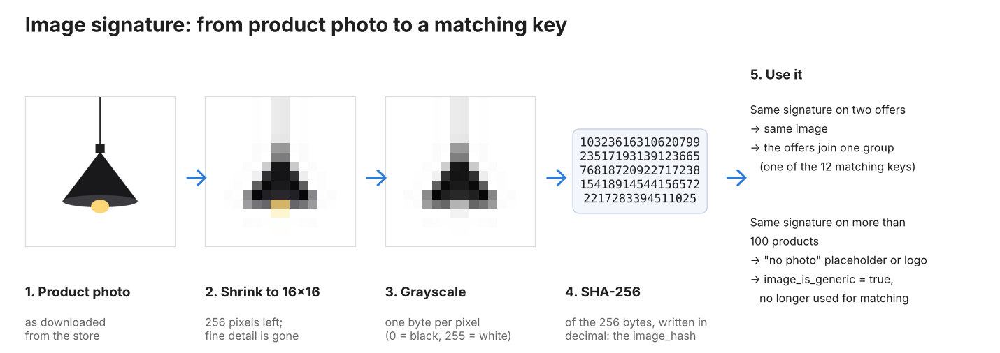
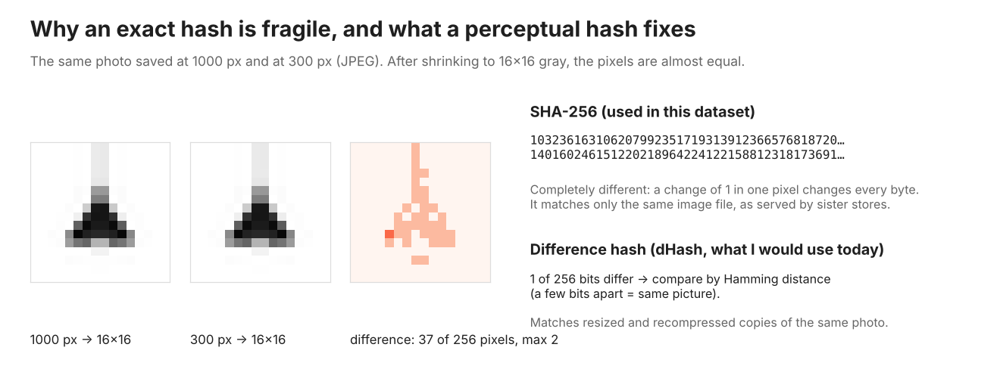
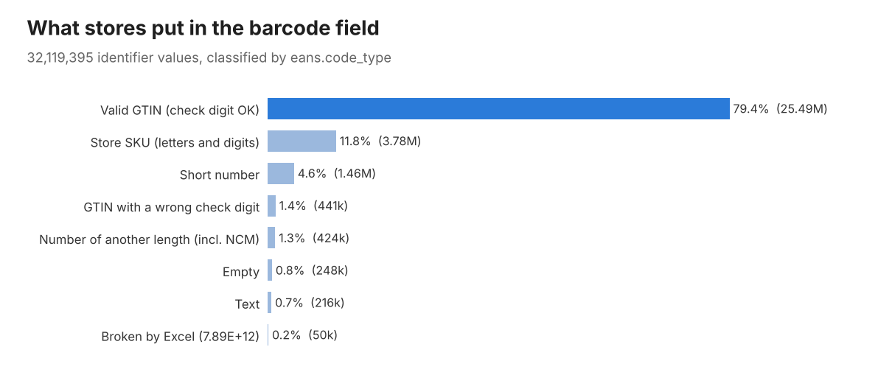

<p align="center">
  
</p>

# Brazilian e-commerce product catalog

[](https://github.com/CaiqueDourado/catalogo-produtos-ecommerce-brasil/actions/workflows/validate.yml)
[](LICENSE-DATA.md)
[](LICENSE)
[](https://www.kaggle.com/datasets/caiquedourado/catalogo-produtos-ecommerce-brasil)
[](https://www.kaggle.com/code/caiquedourado/notebook-catalogo-produtos-ecommerce-brasil)

[Leia em português](README.pt-BR.md)

**114.6 million offers from 7,179 Brazilian online stores, collected from 2019 to 2024**, with spec sheets, barcodes, categories and **18.3 million product groups**: the same item sold by different stores, linked by a matching engine over 11 text and code keys plus an image signature.

| 114.6M | 18.3M | 7,179 | 31.9M | 32.1M | 220M |
|:---:|:---:|:---:|:---:|:---:|:---:|
| offers | product groups | stores with offers | spec-sheet rows | barcodes, classified | category rows |

This repository holds the build scripts, the documentation and a coherent sample (4,030 whole groups with all their offers, spec rows, codes and categories). **The full dataset (9.5 GB of Parquet) is on [Kaggle](https://www.kaggle.com/datasets/caiquedourado/catalogo-produtos-ecommerce-brasil).**

**Contents:** [One product, many stores](#one-product-many-stores) · [What's inside](#whats-inside) · [A look at the data](#a-look-at-the-data) · [How it was built](#how-it-was-built) · [Matching](#matching-the-same-item-in-different-stores) · [Image signature](#the-image-signature) · [Barcodes](#barcodes-in-the-real-world) · [Getting started](#getting-started) · [Data quality](#data-quality-flag-dont-delete) · [What I would do differently](#what-i-would-do-differently)

## One product, many stores

Each store names the same product its own way. The matching engine put these offers, among others, into a single group:

| Store | Name in the store | Matched by |
|---|---|---|
| Submarino | Luminária Pendente Colonial Taschibra Tlf 28 Preta | EAN |
| Americanas | Pendente Taschibra TLF 28 em Alumínio e Vidro Bivolt com Soquete E-27 - Preto | EAN |
| Lojas Incor | Pendente Colonial em Alumínio Preto Ø19,5cm TLF 28 Taschibra | EAN |
| Carrefour | Pendente Colonial em Alumínio Tlf28 Taschibra Preto | EAN |
| Americanas | Pendente em Alumínio Tlf 28 Taschibra E27 - Preto | image signature |
| Extra | Pendente em Alumínio TLF 28 Taschibra E27 - Preto | exact name |

Once the offers are linked, the group shows how much the same item cost in each store:

<p align="center"></p>

Group 415923 in `sample/`: 26 offers, 11 stores, 1 brand, barcode 7897079053111.

## What's inside

| Table | Rows | What it is |
|---|---|---|
| `produtos` | 114,640,012 | One offer: a product in a store, with name, brand, price, availability, group and image signature |
| `grupos` | 18,328,454 | Product groups, with offer, store and brand counts |
| `ficha` | 31,904,957 | Spec sheet, one row per key/value (4,370 keys) |
| `eans` | 32,119,395 | Product identifiers, classified (79% valid GTIN check digits) |
| `categorias` | 220,060,122 | Store category paths, with normalization |
| `lojas` | 17,899 | Stores, with their e-commerce platform |
| `caracteristicas` | 3,102 | Spec keys with the question-style title used on the sites |
| `plataformas` | 13 | VTEX, Shopify, NuvemShop, Magento… |



Largest stores: Magazine Luiza (19.7M offers), Americanas (14.3M), Shoptime (11.2M), Submarino (10.7M), Extra (10.3M), Casas Bahia (9.9M), Amazon (7.3M), Dafiti (5.9M), Pontofrio (4.4M) and Kanui (1.8M). The top 10 hold 83% of the offers; the other 7,169 stores are the long tail of Brazilian e-commerce, found through their platforms and feeds.

## A look at the data

Real rows from `sample/`.

**An offer** (`produtos`):

```yaml
id: 4080167
store_id: 1362                  # Lojas Incor (VTEX)
collected_at: 2019-04-17 02:28:22
name: Pendente Colonial em Alumínio Preto Ø19,5cm TLF 28 Taschibra
brand: Taschibra
price: 113.64                   # price_flag: ok
availability: disponivel        # availability_raw: "in stock"
group_id: 415923
group_rule_original: EAN longo
image_hash: "654620378203191101997613022111…"
image_is_generic: false
```

**A spec sheet** (`ficha`: 32 rows for this iPhone 6s offer, 12 shown):

| position | key | value |
|---:|---|---|
| 2 | Código de Barras | 0888462562348 |
| 3 | Marca | Apple |
| 4 | Modelo | IPhone 6s |
| 5 | Cor | Ouro Rosa |
| 8 | Memória Interna | 16gb |
| 9 | Memória RAM | 2GB |
| 10 | Processador | Chip A9 com Arquitetura de 64 Bits; Coprocessador de Movimento M9 Integrado |
| 14 | Tamanho do Display | 4.7" |
| 15 | Resolução | 1334 X 750 Pixels; 326 Ppi |
| 16 | Câmera Traseira | 12mp |
| 26 | Conteúdo da Embalagem | IPhone com IOS 9; Apple EarPods com Controle Remoto e Microfone; Cabo de Lightning para USB… |
| 27 | Dimensões Aproximadas do Produto - Cm (AxLxP) | 13,8x6,7x0,7cm |

**Spec keys turned into questions** (`caracteristicas`), used as headings on the sites:

| key | question |
|---|---|
| Tamanho da fralda | Qual o Tamanho da fralda? |
| Jarra removível | Possui Jarra removível? |
| Dimensões Aproximadas da Embalagem - cm (AxLxP) | Quais as dimensões da embalagem? (Altura x Largura x Profundidade) |

**Barcodes** (`eans`), one row per code, classified:

| value_raw | code_index | code | code_type |
|---|---:|---|---|
| 7897079053111 | 1 | 7897079053111 | `gtin_valido` |
| 7896181210733,7896181211730 | 1 | 7896181210733 | `gtin_valido` |
| 7896181210733,7896181211730 | 2 | 7896181211730 | `gtin_valido` |
| BB799-6-100-38 | 1 | BB799-6-100-38 | `codigo_alfanumerico` |
| 1000080903171 | 1 | 1000080903171 | `gtin_digito_errado` |
| 9.79E+12 | 1 | 9.79E+12 | `notacao_cientifica` |

**Category paths** (`categorias`), as the stores wrote their breadcrumbs:

```
Smartphones > Celulares e Smartphones > IPhones
Saúde > Produtos Ortopédicos > Equipamentos Médicos e Hospitalares > Ortopedia
Mídias > Livros > Livros e E-books > Biografias
```

**Repairs, with the original kept** (`name_raw` → `name`, 519,564 names):

| name_raw | name |
|---|---|
| Kit Colcha Queen Safari 7 Peças Bia Enxovais Vermelho | Kit Colcha Queen Safari 7 Peças Bia Enxovais Vermelho |
| Douglas Labs Hesperidin Methyl Chalcone - 90 Cápsulas | Douglas Labs Hesperidin Methyl Chalcone - 90 Cápsulas |
| Rosca Postiça Tipo Torquilho de Aço 8(1) X 7/16-20UNF&amp;quot; 15mm | Rosca Postiça Tipo Torquilho de Aço 8(1) X 7/16-20UNF" 15mm |

**Availability, 13 spellings → 2 values:** `http://schema.org/InStock`, `in stock`, `In Stock`, `disponível` → `disponivel`; `out of stock`, `Out Of Stock` → `indisponivel`.

## How it was built



The catalog powered a network of sites I built from 2019 to 2024: price comparison, spec sheets, size guides, brand customer-service pages and "everything about" each product. Every product page on those sites was built from one group in this data:

- [Tudo Sobre Produtos](https://web.archive.org/web/20251021032358/https://tudosobreprodutos.com.br/tudo-sobre-bebedouro-cadence-pure-vita-elegant-0v)
- [Preço Atualizado](https://web.archive.org/web/2020/https://precoatualizado.com.br/)
- [Tamanhos](https://web.archive.org/web/20241107071917/https://tamanhos.com.br/tamanhos-medidas-dimensoes-voltimetro-digital-com-remote-0-a-0v-bateria-som-carro-azul-asx)
- [Atendimento ao Consumidor](https://web.archive.org/web/20201101002617/https://atendimentoaoconsumidor.com.br/assistencia-tecnica-garantia-energetico-monster-energy-47ml)
- [Busca Produto](https://web.archive.org/web/2020/https://buscaproduto.com.br/)

The full runbook of the original pipeline is in [docs/methodology.md](docs/methodology.md).

## Matching: the same item in different stores

The core of the data is `group_id`. For each new offer, the routine collected every offer sharing one of **11 text and code keys or the image signature** (hop 1), then every offer sharing a key with those (hop 2). If any of them already had a group, all joined the lowest group id; otherwise they formed a new group.

<p align="center"></p>

Safeguards that kept it from merging everything:

- **EAN blacklist:** "SEM GTIN", 1000000000000, codes with letters only, codes truncated by Excel ("90E+12") and codes repeated in more than 5 products of the same store (`eans.ignored_in_grouping`).
- **Word check:** EAN matches whose names shared no word were dropped, so a guitar and a car part that a store registered under the same EAN stay apart. 951,000 refusals were logged (308,000 distinct pairs).
- **Generic images and brands:** a signature on more than 100 products, and brands such as "Importado", "Original" or "Não Informado", were not used as keys.

`group_rule_original` keeps the key of the first match; `group_rule` the key after regrouping, which merges more and sometimes chains too far. The 3,107 groups with more than 1,000 offers and the 11,743 with more than 10 brands are flagged in `grupos.group_flag`. Use `group_rule_original` and `group_flag = 'ok'` when precision matters.

The routine itself is published read-only in [legacy/](legacy/), with its known issues. Its logic is now a tested library, **[DedupKit](https://github.com/CaiqueDourado/DedupKit)** (Python and .NET, same results in both). It fixes the fingerprint, checks shared words on every barcode match and refuses pairs whose names state different sizes, voltages or colours. On this dataset's sample, that check alone would split 795 of the 4,030 groups, mostly because they kept every size of a shoe or garment together: "Mass Way 2500 400g" vs "500g", "Squeeze 500ml" vs "750ml", "Toalheiro 220v" vs "127v".

## The image signature

<p align="center"></p>

Every product photo was downloaded (85.8 million download jobs spread over 12 to 15 machines, coordinated by a queue table in SQL Server), shrunk to 16×16 grayscale, and the 16×16 thumbnail was hashed with SHA-256. It is cheap: 256 bytes per image, and comparing two images means comparing two strings in an index.

It did two jobs well:

- **Linking offers that share a photo.** Sister stores (Americanas, Submarino and Shoptime; Casas Bahia, Extra and Pontofrio; Dafiti, Kanui and Tricae) serve the same image file under different product names. In the sample, 4,137 signatures appear in more than one store.
- **Finding placeholder images without looking at them.** A signature on more than 100 products is almost always a "no photo" image or a store logo. Those became `image_is_generic` and stopped linking products.

What it did not do is match the same photo after a store resized or recompressed it. A cryptographic hash changes completely when one pixel changes by 1:

<p align="center"></p>

That is what I would do today, and it is now a library: **[SimilarImageFinder](https://github.com/CaiqueDourado/SimilarImageFinder)** (Python and .NET, same results in both). It keeps the 16×16 gray idea, hashes decoded pixels instead of the encoded thumbnail (the old values also changed when the images moved to AWS), and adds pHash, border trimming, a search index for millions of hashes and the generic-image detector used here. Its benchmark on product photos shows why pHash: aHash and dHash confuse different products on white backgrounds.

## Barcodes in the real world

<p align="center"></p>

One in five values in the "EAN" field of Brazilian stores is not a valid GTIN. `eans.code_type` tells them apart, and `source_key` says which spec-sheet key held the code ("Código de Barras", "Isbn"…).

## What this data can answer

- Which products appear in most stores, and how much the price varies between them.
- Which e-commerce platforms Brazilian stores used, and how big their catalogs were.
- How stores describe the same product: spec-sheet keys, attribute synonyms, categories.
- The real quality of barcodes in Brazilian retail.
- Training and test pairs for product matching (entity resolution) in Portuguese: offers in the same group are positive pairs; the refused EAN pairs are hard negatives (to be published as a separate dataset).

## Getting started

The quickest way in is the [exploratory notebook on Kaggle](https://www.kaggle.com/code/caiquedourado/notebook-catalogo-produtos-ecommerce-brasil): it runs on the full data in about 5 minutes and covers stores, prices, matching keys, barcodes, spec sheets and image signatures.

Full data (Kaggle) with DuckDB:

```python
import duckdb

# Products sold by the most stores, with their price range
duckdb.sql("""
    SELECT g.short_name, g.stores, MIN(p.price) AS min_price, MAX(p.price) AS max_price
    FROM 'produtos/*.parquet' p
    JOIN 'grupos.parquet' g ON g.id = p.group_id
    WHERE g.group_flag = 'ok' AND p.price IS NOT NULL
    GROUP BY ALL
    ORDER BY g.stores DESC
    LIMIT 20
""")

# Most common spec-sheet keys
duckdb.sql("SELECT key, COUNT(*) AS n FROM 'ficha/*.parquet' GROUP BY key ORDER BY n DESC LIMIT 20")

# Barcode quality by store
duckdb.sql("""
    SELECT l.name, AVG((e.code_type = 'gtin_valido')::INT) AS valid_gtin_share, COUNT(*) AS codes
    FROM 'eans/*.parquet' e
    JOIN 'produtos/*.parquet' p ON p.id = e.product_id
    JOIN 'lojas.parquet' l ON l.id = p.store_id
    GROUP BY ALL HAVING COUNT(*) > 10000
    ORDER BY valid_gtin_share
""")
```

The sample in this repository is in `sample/` (CSV, ~18 MB), with the same file and column names as the full data. With pandas:

```python
import pandas as pd
produtos = pd.read_csv("sample/produtos.csv")
grupos = pd.read_csv("sample/grupos.csv")
```

## Data quality: flag, don't delete

Every corrected value keeps the original in a `*_raw` column and the reason in a `*_flag` column:

| Problem found | Rows | In the data |
|---|---:|---|
| Price 0 | 28.1M | `price` empty, `price_flag = zero` |
| Price 99,999.99 (the crawler's "inactive" marker) | 1.5M | `price_flag = inativo_99999` |
| Mojibake and HTML entities in names | 519,564 | `name_flag = reparado` |
| Groups chained by regrouping | 14,850 | `group_flag` |
| Category pieces that are SEO tags or internal codes | 5.9M | `category_flag` |
| Barcodes that are not valid GTINs | 6.6M | `code_type` |

The only deletion: customer-service contacts of brands that asked for removal (224 rows). `scripts/validate.py` checks counts, keys and every cleaning rule, and runs on the sample in CI.

## Documentation

- [Data dictionary](docs/data-dictionary.md) ([português](docs/data-dictionary.pt-BR.md)): every column and its values
- [Methodology](docs/methodology.md): the original runbook, collection, matching, normalization and build
- [Data quality](docs/data-quality.md): what was fixed, what was only flagged and what was lost at the source

## What I would do differently

- **Keep raw data before normalizing.** Names, brands and categories were normalized in place in 2020, and the stores' original text was lost. A plural rule turned "Home" into "Homes".
- **Test text functions with Portuguese cases.** The fingerprint I used dropped every other word. A category routine deleted every category containing a digit, such as "Galaxy J5".
- **Keep ingestion apart from enrichment.** Loading downloaded images back cleared the product's group, which explains part of the 7.4M offers without a group.
- **Use a perceptual hash for images**, as shown above: now [SimilarImageFinder](https://github.com/CaiqueDourado/SimilarImageFinder).
- **Compare attributes before merging.** A shared barcode or photo is not enough when the names say 400g and 500g: now [DedupKit](https://github.com/CaiqueDourado/DedupKit).

## Related

- [pares-matching-produtos-ptbr](https://github.com/CaiqueDourado/pares-matching-produtos-ptbr): labelled pairs of these offers for product matching, with hard negatives and 780 pairs checked one by one ([Kaggle](https://www.kaggle.com/datasets/caiquedourado/pares-matching-produtos-ptbr)).
- [DedupKit](https://github.com/CaiqueDourado/DedupKit): the matching of this catalog, rewritten as a Python and .NET library, with an attribute check and an audit trail.
- [SimilarImageFinder](https://github.com/CaiqueDourado/SimilarImageFinder): the image signature of this catalog, rewritten as a Python and .NET library with perceptual hashes.
- [taxonomia-google-produtos-ptbr](https://github.com/CaiqueDourado/taxonomia-google-produtos-ptbr): Google's product taxonomy in Portuguese, used to classify products from this data lake.
- [municipios-e-estados-do-brasil](https://github.com/CaiqueDourado/municipios-e-estados-do-brasil), [paises-do-mundo-ptbr](https://github.com/CaiqueDourado/paises-do-mundo-ptbr) and [nomes-e-sobrenomes-brasil](https://github.com/CaiqueDourado/nomes-e-sobrenomes-brasil): other reference tables from the same data lake.

## License and use

- **Data:** CC BY 4.0 ([LICENSE-DATA.md](LICENSE-DATA.md)).
- **Code:** MIT.
- **Store content:** names, brands and spec sheets are factual information collected from stores and public affiliate feeds. Images are not distributed, only their signatures.

## Citation

See [CITATION.cff](CITATION.cff). Made by [Caique Dourado](https://github.com/CaiqueDourado).
