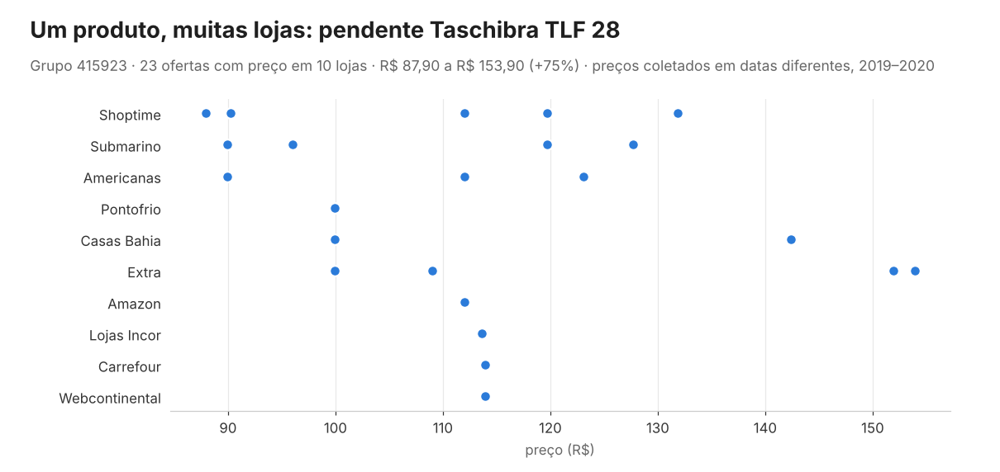
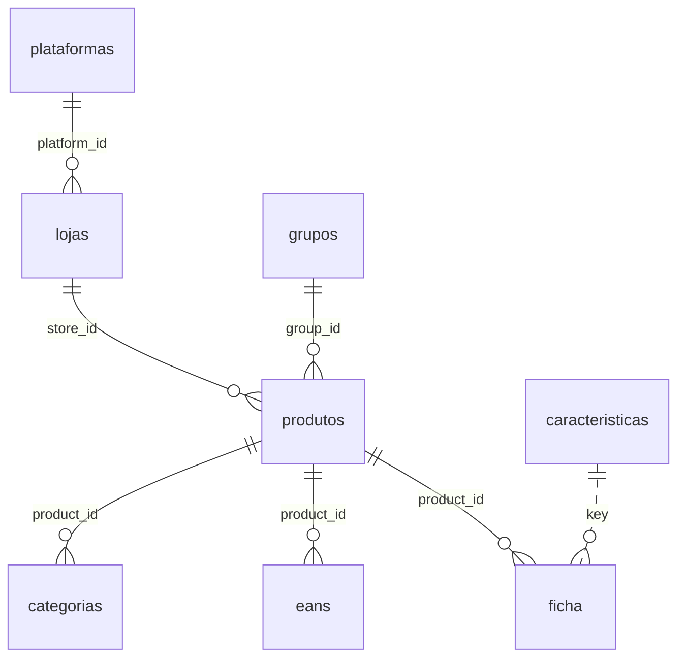
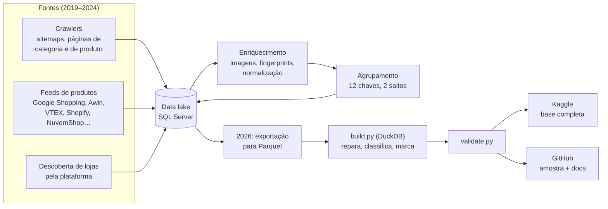
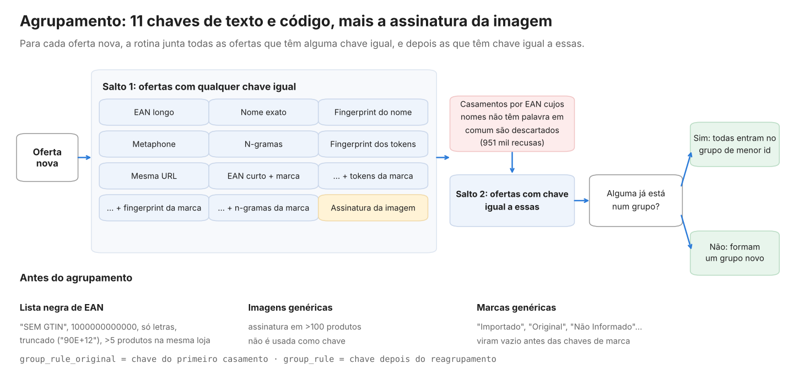
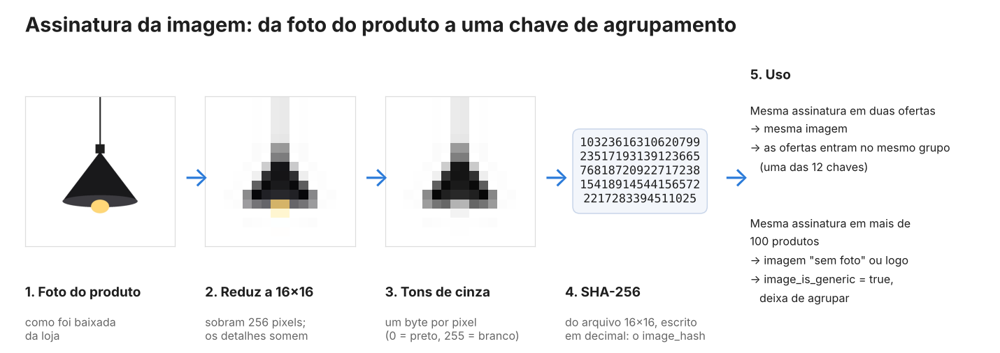
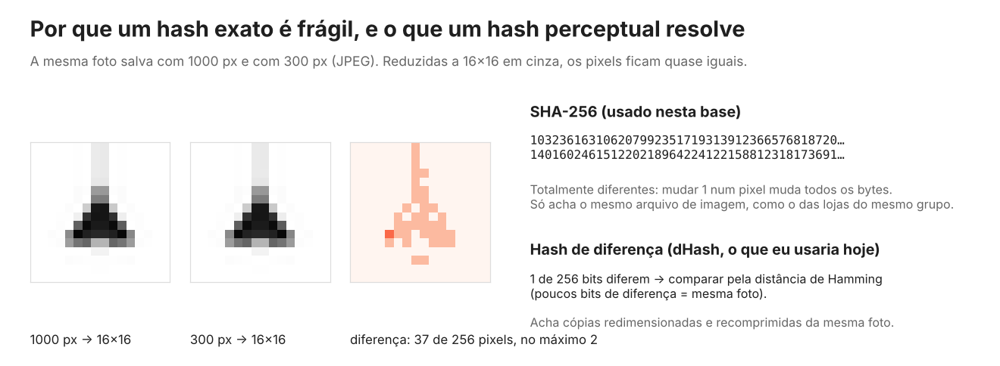
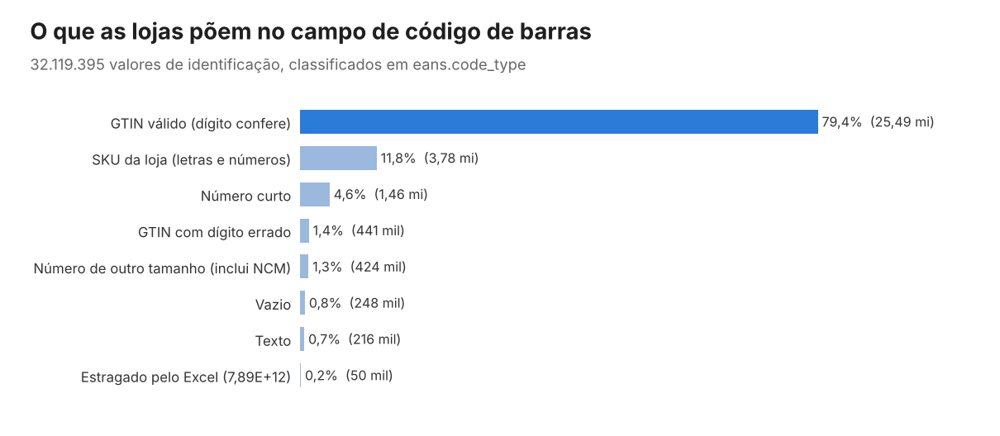

<p align="center">
  
</p>

# Catálogo de produtos do e-commerce brasileiro

[](https://github.com/CaiqueDourado/catalogo-produtos-ecommerce-brasil/actions/workflows/validate.yml)
[](LICENSE-DATA.md)
[](LICENSE)
[](https://www.kaggle.com/datasets/caiquedourado/catalogo-produtos-ecommerce-brasil)
[](https://www.kaggle.com/code/caiquedourado/notebook-catalogo-produtos-ecommerce-brasil)

[Read in English](README.md)

**114,6 milhões de ofertas de 7.179 lojas brasileiras, coletadas entre 2019 e 2024**, com ficha técnica, códigos de barras, categorias e **18,3 milhões de grupos de produto**: a mesma peça vendida em lojas diferentes, ligada por um agrupamento com 11 chaves de texto e código, mais a assinatura da imagem.

| 114,6 mi | 18,3 mi | 7.179 | 31,9 mi | 32,1 mi | 220 mi |
|:---:|:---:|:---:|:---:|:---:|:---:|
| ofertas | grupos de produto | lojas com ofertas | linhas de ficha técnica | códigos de barras, classificados | linhas de categoria |

Este repositório tem os scripts que geram a base, a documentação e uma amostra coerente (4.030 grupos inteiros, com todas as ofertas, fichas, códigos e categorias). **A base completa (9,5 GB em Parquet) está no [Kaggle](https://www.kaggle.com/datasets/caiquedourado/catalogo-produtos-ecommerce-brasil).**

**Conteúdo:** [Um produto, muitas lojas](#um-produto-muitas-lojas) · [O que tem na base](#o-que-tem-na-base) · [Os dados de perto](#os-dados-de-perto) · [Como foi construída](#como-foi-construída) · [Agrupamento](#o-agrupamento-a-mesma-peça-em-lojas-diferentes) · [Assinatura da imagem](#a-assinatura-da-imagem) · [Códigos de barras](#códigos-de-barras-na-vida-real) · [Começando](#começando) · [Qualidade](#qualidade-marcar-não-apagar) · [O que eu faria diferente](#o-que-eu-faria-diferente)

## Um produto, muitas lojas

Cada loja dá ao mesmo produto um nome diferente. O agrupamento pôs estas ofertas, entre outras, num único grupo:

| Loja | Nome na loja | Ligada por |
|---|---|---|
| Submarino | Luminária Pendente Colonial Taschibra Tlf 28 Preta | EAN |
| Americanas | Pendente Taschibra TLF 28 em Alumínio e Vidro Bivolt com Soquete E-27 - Preto | EAN |
| Lojas Incor | Pendente Colonial em Alumínio Preto Ø19,5cm TLF 28 Taschibra | EAN |
| Carrefour | Pendente Colonial em Alumínio Tlf28 Taschibra Preto | EAN |
| Americanas | Pendente em Alumínio Tlf 28 Taschibra E27 - Preto | assinatura da imagem |
| Extra | Pendente em Alumínio TLF 28 Taschibra E27 - Preto | nome exato |

Com as ofertas ligadas, o grupo mostra quanto a mesma peça custava em cada loja:

<p align="center"></p>

Grupo 415923 em `sample/`: 26 ofertas, 11 lojas, 1 marca, código de barras 7897079053111.

## O que tem na base

| Tabela | Linhas | O que é |
|---|---|---|
| `produtos` | 114.640.012 | Uma oferta: produto numa loja, com nome, marca, preço, disponibilidade, grupo e assinatura da imagem |
| `grupos` | 18.328.454 | Grupos de produto, com número de ofertas, lojas e marcas |
| `ficha` | 31.904.957 | Ficha técnica, uma linha por chave/valor (4.370 chaves) |
| `eans` | 32.119.395 | Códigos de identificação, classificados (79% GTIN com dígito verificador válido) |
| `categorias` | 220.060.122 | Caminhos de categoria das lojas, com normalização |
| `lojas` | 17.899 | Lojas, com plataforma de e-commerce |
| `caracteristicas` | 3.102 | Chaves da ficha com o título em forma de pergunta usado nos sites |
| `plataformas` | 13 | VTEX, Shopify, NuvemShop, Magento… |



As maiores lojas: Magazine Luiza (19,7 mi ofertas), Americanas (14,3 mi), Shoptime (11,2 mi), Submarino (10,7 mi), Extra (10,3 mi), Casas Bahia (9,9 mi), Amazon (7,3 mi), Dafiti (5,9 mi), Pontofrio (4,4 mi) e Kanui (1,8 mi). As 10 maiores somam 83% das ofertas; as outras 7.169 lojas são a cauda longa do e-commerce brasileiro, encontradas pela plataforma e pelos feeds de cada uma.

## Os dados de perto

Linhas reais de `sample/`.

**Uma oferta** (`produtos`):

```yaml
id: 4080167
store_id: 1362                  # Lojas Incor (VTEX)
collected_at: 2019-04-17 02:28:22
name: Pendente Colonial em Alumínio Preto Ø19,5cm TLF 28 Taschibra
brand: Taschibra
price: 113.64                   # price_flag: ok
availability: disponivel        # availability_raw: "in stock"
group_id: 415923
group_rule_original: EAN longo
image_hash: "654620378203191101997613022111…"
image_is_generic: false
```

**Uma ficha técnica** (`ficha`: 32 linhas para esta oferta do iPhone 6s, 12 mostradas):

| position | key | value |
|---:|---|---|
| 2 | Código de Barras | 0888462562348 |
| 3 | Marca | Apple |
| 4 | Modelo | IPhone 6s |
| 5 | Cor | Ouro Rosa |
| 8 | Memória Interna | 16gb |
| 9 | Memória RAM | 2GB |
| 10 | Processador | Chip A9 com Arquitetura de 64 Bits; Coprocessador de Movimento M9 Integrado |
| 14 | Tamanho do Display | 4.7" |
| 15 | Resolução | 1334 X 750 Pixels; 326 Ppi |
| 16 | Câmera Traseira | 12mp |
| 26 | Conteúdo da Embalagem | IPhone com IOS 9; Apple EarPods com Controle Remoto e Microfone; Cabo de Lightning para USB… |
| 27 | Dimensões Aproximadas do Produto - Cm (AxLxP) | 13,8x6,7x0,7cm |

**Chaves da ficha viradas em perguntas** (`caracteristicas`), usadas como títulos nos sites:

| key | question |
|---|---|
| Tamanho da fralda | Qual o Tamanho da fralda? |
| Jarra removível | Possui Jarra removível? |
| Dimensões Aproximadas da Embalagem - cm (AxLxP) | Quais as dimensões da embalagem? (Altura x Largura x Profundidade) |

**Códigos de barras** (`eans`), uma linha por código, classificados:

| value_raw | code_index | code | code_type |
|---|---:|---|---|
| 7897079053111 | 1 | 7897079053111 | `gtin_valido` |
| 7896181210733,7896181211730 | 1 | 7896181210733 | `gtin_valido` |
| 7896181210733,7896181211730 | 2 | 7896181211730 | `gtin_valido` |
| BB799-6-100-38 | 1 | BB799-6-100-38 | `codigo_alfanumerico` |
| 1000080903171 | 1 | 1000080903171 | `gtin_digito_errado` |
| 9.79E+12 | 1 | 9.79E+12 | `notacao_cientifica` |

**Caminhos de categoria** (`categorias`), como as lojas escreveram os breadcrumbs:

```
Smartphones > Celulares e Smartphones > IPhones
Saúde > Produtos Ortopédicos > Equipamentos Médicos e Hospitalares > Ortopedia
Mídias > Livros > Livros e E-books > Biografias
```

**Reparos, com o original guardado** (`name_raw` → `name`, 519.564 nomes):

| name_raw | name |
|---|---|
| Kit Colcha Queen Safari 7 Peças Bia Enxovais Vermelho | Kit Colcha Queen Safari 7 Peças Bia Enxovais Vermelho |
| Douglas Labs Hesperidin Methyl Chalcone - 90 Cápsulas | Douglas Labs Hesperidin Methyl Chalcone - 90 Cápsulas |
| Rosca Postiça Tipo Torquilho de Aço 8(1) X 7/16-20UNF&amp;quot; 15mm | Rosca Postiça Tipo Torquilho de Aço 8(1) X 7/16-20UNF" 15mm |

**Disponibilidade, 13 grafias → 2 valores:** `http://schema.org/InStock`, `in stock`, `In Stock`, `disponível` → `disponivel`; `out of stock`, `Out Of Stock` → `indisponivel`.

## Como foi construída



O catálogo foi a base de uma rede de sites que eu construí entre 2019 e 2024: comparação de preços, fichas técnicas, guias de tamanho, SAC das marcas e "tudo sobre" cada produto. Cada página de produto desses sites era montada a partir de um grupo desta base:

- [Tudo Sobre Produtos](https://web.archive.org/web/20251021032358/https://tudosobreprodutos.com.br/tudo-sobre-bebedouro-cadence-pure-vita-elegant-0v)
- [Preço Atualizado](https://web.archive.org/web/2020/https://precoatualizado.com.br/)
- [Tamanhos](https://web.archive.org/web/20241107071917/https://tamanhos.com.br/tamanhos-medidas-dimensoes-voltimetro-digital-com-remote-0-a-0v-bateria-som-carro-azul-asx)
- [Atendimento ao Consumidor](https://web.archive.org/web/20201101002617/https://atendimentoaoconsumidor.com.br/assistencia-tecnica-garantia-energetico-monster-energy-47ml)
- [Busca Produto](https://web.archive.org/web/2020/https://buscaproduto.com.br/)

O roteiro completo do pipeline original está em [docs/methodology.md](docs/methodology.md).

## O agrupamento: a mesma peça em lojas diferentes

O coração da base é a coluna `group_id`. Para cada oferta nova, a rotina juntava todas as ofertas com alguma de **11 chaves de texto e código, ou a assinatura da imagem**, igual à dela (salto 1), e depois as ofertas com chave igual a essas (salto 2). Se alguma já tinha grupo, todas entravam no grupo de menor id; se não, formavam um grupo novo.

<p align="center"></p>

As proteções que impediam de juntar tudo:

- **Lista negra de EAN:** "SEM GTIN", 1000000000000, códigos só com letras, códigos truncados pelo Excel ("90E+12") e códigos repetidos em mais de 5 produtos da mesma loja (`eans.ignored_in_grouping`).
- **Conferência de palavras:** casamentos por EAN cujos nomes não tinham nenhuma palavra em comum eram descartados, para não juntar uma guitarra e uma peça de carro que a loja cadastrou com o mesmo EAN. Foram registradas 951 mil recusas (308 mil pares distintos).
- **Imagens e marcas genéricas:** uma assinatura em mais de 100 produtos, e marcas como "Importado", "Original" ou "Não Informado", não eram usadas como chave.

`group_rule_original` guarda a chave do primeiro casamento; `group_rule`, a chave depois do reagrupamento, que junta mais e às vezes encadeia demais. Os 3.107 grupos com mais de 1.000 ofertas e os 11.743 com mais de 10 marcas estão marcados em `grupos.group_flag`. Use `group_rule_original` e `group_flag = 'ok'` quando precisar de precisão.

A rotina está publicada, só para leitura, em [legacy/](legacy/), com os problemas conhecidos. A lógica dela virou uma biblioteca testada, **[DedupKit](https://github.com/CaiqueDourado/DedupKit)** (Python e .NET, com os mesmos resultados nas duas). Ela corrige o fingerprint, confere palavras em todo casamento por código e recusa pares cujos nomes dizem tamanhos, voltagens ou cores diferentes. Na amostra deste dataset, só essa conferência dividiria 795 dos 4.030 grupos, a maioria porque juntavam todos os tamanhos de um calçado ou roupa: "Mass Way 2500 400g" vs "500g", "Squeeze 500ml" vs "750ml", "Toalheiro 220v" vs "127v".

## A assinatura da imagem

<p align="center"></p>

Cada foto de produto foi baixada (85,8 milhões de tarefas de download distribuídas entre 12 e 15 máquinas, coordenadas por uma fila em tabela do SQL Server), reduzida a 16×16 em tons de cinza, e a miniatura 16×16 foi passada por SHA-256. É barato: 256 bytes por imagem, e comparar duas imagens é comparar dois textos num índice.

Funcionou bem em duas frentes:

- **Ligar ofertas que usam a mesma foto.** Lojas do mesmo grupo (Americanas, Submarino e Shoptime; Casas Bahia, Extra e Pontofrio; Dafiti, Kanui e Tricae) servem o mesmo arquivo de imagem com nomes de produto diferentes. Na amostra, 4.137 assinaturas aparecem em mais de uma loja.
- **Achar imagens genéricas sem olhar uma por uma.** Uma assinatura em mais de 100 produtos é quase sempre um "sem foto" ou o logo da loja. Essas imagens viraram `image_is_generic` e deixaram de agrupar produtos.

O que ela não fazia era reconhecer a mesma foto depois que a loja a redimensionou ou recomprimiu. Um hash criptográfico muda por inteiro quando um pixel muda em 1:

<p align="center"></p>

É o que eu faria hoje, e virou uma biblioteca: **[SimilarImageFinder](https://github.com/CaiqueDourado/SimilarImageFinder)** (Python e .NET, com os mesmos resultados nas duas). Ela mantém a ideia do 16×16 em cinza, calcula o hash sobre os pixels decodificados em vez da miniatura codificada (os valores antigos também mudaram quando as imagens foram para a AWS) e acrescenta pHash, remoção de borda, um índice de busca para milhões de hashes e o detector de imagens genéricas usado aqui. O teste dela com fotos de produto mostra por que pHash: aHash e dHash confundem produtos diferentes em fundo branco.

## Códigos de barras na vida real

<p align="center"></p>

Um em cada cinco valores no campo "EAN" das lojas brasileiras não é um GTIN válido. `eans.code_type` separa os casos, e `source_key` diz em que chave da ficha o código estava ("Código de Barras", "Isbn"…).

## O que esses dados respondem

- Quais produtos aparecem em mais lojas, e quanto o preço varia entre elas.
- Quais plataformas de e-commerce as lojas brasileiras usavam, e que tamanho de catálogo cada uma tinha.
- Como as lojas descrevem o mesmo produto: chaves de ficha técnica, sinônimos de atributos, categorias.
- A qualidade real dos códigos de barras no varejo brasileiro.
- Pares de treino e teste para casamento de produtos (entity resolution) em português: ofertas do mesmo grupo são pares positivos; os pares de EAN recusados são negativos difíceis (serão publicados numa base à parte).

## Começando

O jeito mais rápido de começar é o [notebook de exploração no Kaggle](https://www.kaggle.com/code/caiquedourado/notebook-catalogo-produtos-ecommerce-brasil): roda na base completa em cerca de 5 minutos e cobre lojas, preços, chaves de agrupamento, códigos de barras, fichas técnicas e assinaturas de imagem.

Base completa (Kaggle) com DuckDB:

```python
import duckdb

# Produtos vendidos em mais lojas, com a faixa de preço
duckdb.sql("""
    SELECT g.short_name, g.stores, MIN(p.price) AS min_price, MAX(p.price) AS max_price
    FROM 'produtos/*.parquet' p
    JOIN 'grupos.parquet' g ON g.id = p.group_id
    WHERE g.group_flag = 'ok' AND p.price IS NOT NULL
    GROUP BY ALL
    ORDER BY g.stores DESC
    LIMIT 20
""")

# Chaves de ficha técnica mais comuns
duckdb.sql("SELECT key, COUNT(*) AS n FROM 'ficha/*.parquet' GROUP BY key ORDER BY n DESC LIMIT 20")

# Qualidade dos códigos de barras por loja
duckdb.sql("""
    SELECT l.name, AVG((e.code_type = 'gtin_valido')::INT) AS valid_gtin_share, COUNT(*) AS codes
    FROM 'eans/*.parquet' e
    JOIN 'produtos/*.parquet' p ON p.id = e.product_id
    JOIN 'lojas.parquet' l ON l.id = p.store_id
    GROUP BY ALL HAVING COUNT(*) > 10000
    ORDER BY valid_gtin_share
""")
```

A amostra deste repositório está em `sample/` (CSV, ~18 MB), com os mesmos nomes de arquivo e de coluna da base completa. Com pandas:

```python
import pandas as pd
produtos = pd.read_csv("sample/produtos.csv")
grupos = pd.read_csv("sample/grupos.csv")
```

## Qualidade: marcar, não apagar

Todo valor corrigido mantém o original numa coluna `*_raw`, e o motivo numa coluna `*_flag`:

| Problema encontrado | Linhas | Na base |
|---|---:|---|
| Preço 0 | 28,1 mi | `price` vazio, `price_flag = zero` |
| Preço 99.999,99 (marca de "inativo" do crawler) | 1,5 mi | `price_flag = inativo_99999` |
| Texto embaralhado e códigos HTML nos nomes | 519.564 | `name_flag = reparado` |
| Grupos encadeados pelo reagrupamento | 14.850 | `group_flag` |
| Pedaços de categoria que são tags de SEO ou códigos internos | 5,9 mi | `category_flag` |
| Códigos de barras que não são GTIN válido | 6,6 mi | `code_type` |

A única exclusão: contatos de SAC das marcas que pediram remoção (224 linhas). O `scripts/validate.py` confere contagens, chaves e cada regra de limpeza, e roda sobre a amostra no CI.

## Documentação

- [Dicionário de dados](docs/data-dictionary.pt-BR.md) ([English](docs/data-dictionary.md)): todas as colunas e seus valores
- [Metodologia](docs/methodology.md): o roteiro original, coleta, agrupamento, normalização e build
- [Qualidade dos dados](docs/data-quality.md): o que foi corrigido, o que foi só marcado e o que se perdeu na origem

## O que eu faria diferente

- **Guardar o dado bruto antes de normalizar.** Nome, marca e categoria foram normalizados no próprio lugar em 2020, e o texto original da loja se perdeu. Uma regra de plural transformou "Home" em "Homes".
- **Testar as funções de texto com casos em português.** O fingerprint que eu usava descartava uma palavra sim, uma não. Uma rotina de categorias apagou toda categoria com número, como "Galaxy J5".
- **Separar ingestão de enriquecimento.** A carga das imagens baixadas zerava o grupo do produto, e por isso parte das 7,4 milhões de ofertas está sem grupo.
- **Usar um hash perceptual nas imagens**, como mostrado acima: agora na [SimilarImageFinder](https://github.com/CaiqueDourado/SimilarImageFinder).
- **Comparar atributos antes de juntar.** Mesmo EAN ou mesma foto não basta quando os nomes dizem 400g e 500g: agora no [DedupKit](https://github.com/CaiqueDourado/DedupKit).

## Relacionados

- [pares-matching-produtos-ptbr](https://github.com/CaiqueDourado/pares-matching-produtos-ptbr): pares rotulados destas ofertas para matching de produtos, com negativos difíceis e 780 pares conferidos um a um ([Kaggle](https://www.kaggle.com/datasets/caiquedourado/pares-matching-produtos-ptbr)).
- [DedupKit](https://github.com/CaiqueDourado/DedupKit): o agrupamento deste catálogo, reescrito como biblioteca em Python e .NET, com conferência de atributos e trilha de auditoria.
- [SimilarImageFinder](https://github.com/CaiqueDourado/SimilarImageFinder): a assinatura de imagem deste catálogo, reescrita como biblioteca em Python e .NET, com hashes perceptuais.
- [taxonomia-google-produtos-ptbr](https://github.com/CaiqueDourado/taxonomia-google-produtos-ptbr): a taxonomia de produtos do Google em português, usada para classificar produtos deste data lake.
- [municipios-e-estados-do-brasil](https://github.com/CaiqueDourado/municipios-e-estados-do-brasil) e [paises-do-mundo-ptbr](https://github.com/CaiqueDourado/paises-do-mundo-ptbr): outras tabelas de referência do mesmo projeto.

## Licença e uso

- **Dados:** CC BY 4.0 ([LICENSE-DATA.md](LICENSE-DATA.md)).
- **Código:** MIT.
- **Conteúdo das lojas:** nomes, marcas e fichas técnicas são informação factual coletada das lojas e de feeds públicos de afiliados. As imagens não são distribuídas, só a assinatura de cada uma.

## Como citar

Veja [CITATION.cff](CITATION.cff). Feito por [Caique Dourado](https://github.com/CaiqueDourado).
